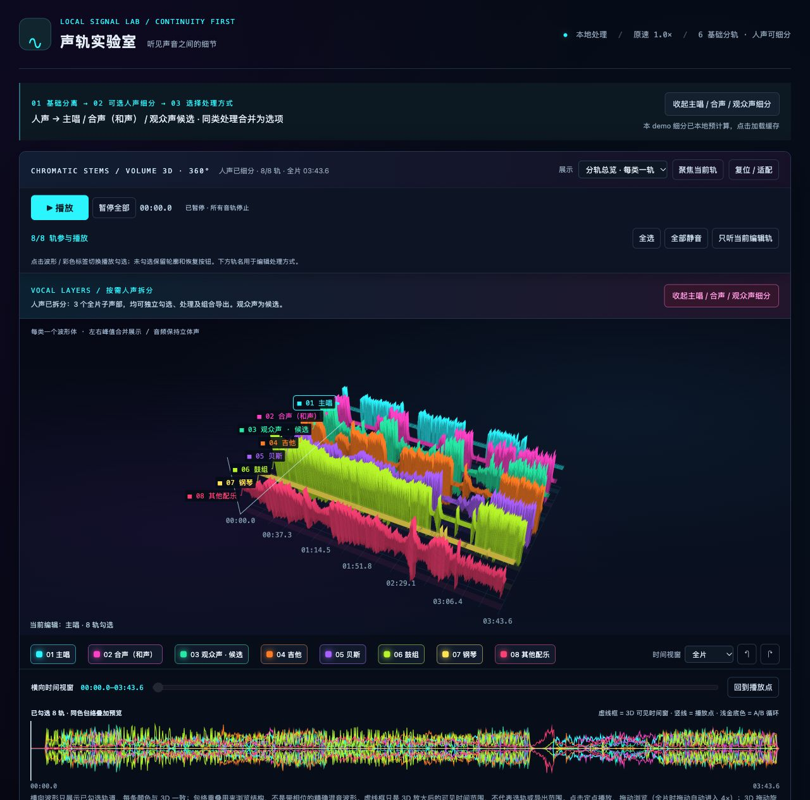

# raremindandry-music-analysis

本地音频分轨、连续人声处理、信号评价与交互式 3D 波形实验项目。

## 界面预览



本地 Demo 实际截图：人声展开为主唱 / 合声（和声） / 观众声候选，与吉他、贝斯、鼓组、钢琴和其他配乐在同一个 3D 图中展示。每条轨道对应一种颜色；下方时间轴显示所选轨道的同色包络叠加。实际界面支持 360° 旋转、缩放、勾选混听和组合导出。

截图仅展示界面，不附带演示音频，也不代表已部署的在线服务。观众声、钢琴等仍是模型分离候选，可能存在串音或弱信号。

这是开发中的源码版本。仓库不包含用户歌曲、原视频、分轨音频、模型权重、Python 虚拟环境或已生成的试听网页。克隆仓库不会直接获得原演示音频；请使用有权处理的音频在本机生成结果。

## 当前能力

- 全片基础分离：人声、吉他、贝斯、鼓组、钢琴候选及其他配乐，每类一个轨道。
- 按需人声细分：主唱、合声（和声）、观众声候选；总人声与子轨不会重复混入。
- 每轨独立选择原始 / 保守清理 / 连续保留等已有处理版本。连续方式以原残差回填为主，不修音、不生成音符。
- 暗色原生 WebGL 波形：每轨一个展示体，左右峰值合并展示，播放仍保持立体声；360° 旋转、独立空间缩放、轨道间距、时间拖动和定点播放。
- 统一声源颜色、编号及标签连接线；静音轨保留可恢复轮廓。横向波形叠加显示已勾选轨道的同色包络。
- 多轨组合试听与 WAV 24-bit / MP3 320 kbps 导出，支持全片、自定义起止时间、A/B 范围，附带可复现组合清单。
- 音质、洁净度、稳定性、连续性等 0–10 分信号代理指标，保留一位小数。

## 目录

```text
work/
  vocal-detail/
    initialize_audio.py       两阶段处理入口
    continuous_vocals.py      连续优先人声策略
    clean_vocals.py           原相位保守清理
    export_mix.py             本地立体声组合导出
    build_audio_insights.py   波形与信号代理评价
    refresh_player.py         刷新已有演示源码
    processing_defaults.json  处理和视觉默认参数
    player_template.html      当前网页模板
    web/                      JS / CSS 前端
    test_*.js / test_*.py      回归测试
  demucs-detailed/
    run_specialists.py        RoFormer / VR / MDX 专用模型入口
    separate_full_instruments.py
    serve_demo.py             网页、音频 Range 与导出 API
outputs/instrument_demo/      本机生成，Git 忽略
```

其他 `build_*`、`repair_*` 和打包脚本保留了早期实验与已有 Demo 的生成逻辑，依赖相应本地中间结果，并不是每个脚本都能在空目录直接运行。

## 环境准备

本地主要验证环境为 macOS Apple Silicon。专用分离器使用 Python 3.12；Demucs 使用独立环境，本地验证版本为 Python 3.9。模型运行在本机，首次下载模型需要联网；不调用远程音频处理 API。

```bash
python3.12 -m venv work/separator-env
work/separator-env/bin/python -m pip install -r requirements-separator.txt

python3.9 -m venv work/demucs-env
work/demucs-env/bin/python -m pip install -r requirements-demucs.txt
```

只做已生成结果的分析 / 网页刷新 / 组合导出时，可在 `separator-env` 安装较轻的 `requirements-core.txt`，不必安装整个分离器。FFmpeg 可由 `imageio-ffmpeg` 提供。前端无需 npm 构建，Node.js 仅用于 JS 回归测试。

模型文件默认位于 `work/demucs-detailed/models/`，由 `audio-separator` 的模型下载机制取得，或按其官方说明放置对应模型和配置。模型名称与校验值见 `run_specialists.py`；模型及依赖的软件许可需分别遵守，不在本仓库重新分发权重。

## 使用自己的音频

基础分离使用新的输出目录，避免覆盖已处理音频：

```bash
work/separator-env/bin/python work/vocal-detail/initialize_audio.py \
  --input /path/to/your-song.mov \
  --out outputs/instrument_demo
```

按需进行第二阶段人声细分：

```bash
work/separator-env/bin/python work/vocal-detail/initialize_audio.py \
  --out outputs/instrument_demo --expand-vocals
```

人声细分按钮只展开已在本机完成的缓存结果，不在浏览器里运行模型。Crowd 等专用模型需在对应模型文件与配置准备完成后运行。

刷新现有结果的页面，并启动支持导出的本地服务：

```bash
work/separator-env/bin/python work/vocal-detail/refresh_player.py
work/separator-env/bin/python work/demucs-detailed/serve_demo.py
```

打开 <http://127.0.0.1:8874/>。服务只绑定本机，默认读取 `outputs/instrument_demo/`。如果 8874 已被旧 Demo 占用，请先确认并停止对应进程，避免运行两个实例。

导出是“生成文件”操作，完成后需点击页面的下载链接；当前版本不自动触发浏览器下载。导出使用点击时的组合、处理方式及时间快照，后续修改选择不会改变在途任务。

## 回归检查

以下检查不需要歌曲或模型：

```bash
node work/vocal-detail/test_stem_mixer.js
node work/vocal-detail/test_transport_races.js
node work/vocal-detail/test_export_range.js
```

已有本地分轨、manifest 和波形资源后，再运行真实数据几何与导出检查：

```bash
node work/vocal-detail/test_unified_wave.js
work/separator-env/bin/python work/vocal-detail/test_export_mix.py
```

这两项测试目前面向原 Demo 的轨道 schema 与固定测试时间段，并非通用音乐基准。所有 Python 文件也可先进行语法编译检查。

## 限制与隐私

- 分轨是模型估计，仍可能串音、丢失尾音或重叠。观众声是候选，不证明真的有人群；弱钢琴轨也不证明该乐器存在。
- 信号评价不是人工听测、真实分离准确率或跨乐器排名。
- 连续处理、去混响、降噪可能改变细节，需与原始分轨对照；不能保证恢复全部特效或逐位歌手分离。
- 横向彩色包络是结构预览，不是带相位的精确混音波形。实际试听和导出使用音频源；固定预留混听余量，不自动放大未静音轨。
- 本地服务器和部署密钥不应直接暴露到公网。公开部署需要独立的身份验证、存储权限、任务队列和资源控制方案。
- `.gitignore` 排除媒体、生成结果、模型和密钥。SSH 私钥不属于项目文件，请保留在受保护的本机目录。

更多代码入口见 [CODE_MAP](work/vocal-detail/CODE_MAP.md)，组合操作见 [COMBINATION_EXPORT](work/vocal-detail/COMBINATION_EXPORT.md)。项目当前未另行指定开源许可证；第三方模型与依赖各自保留其许可证。
